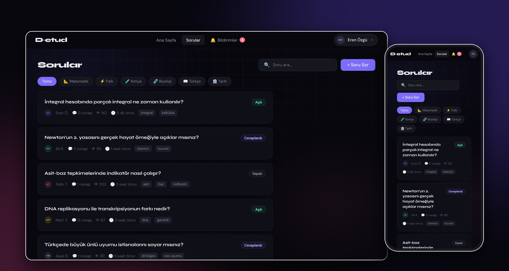
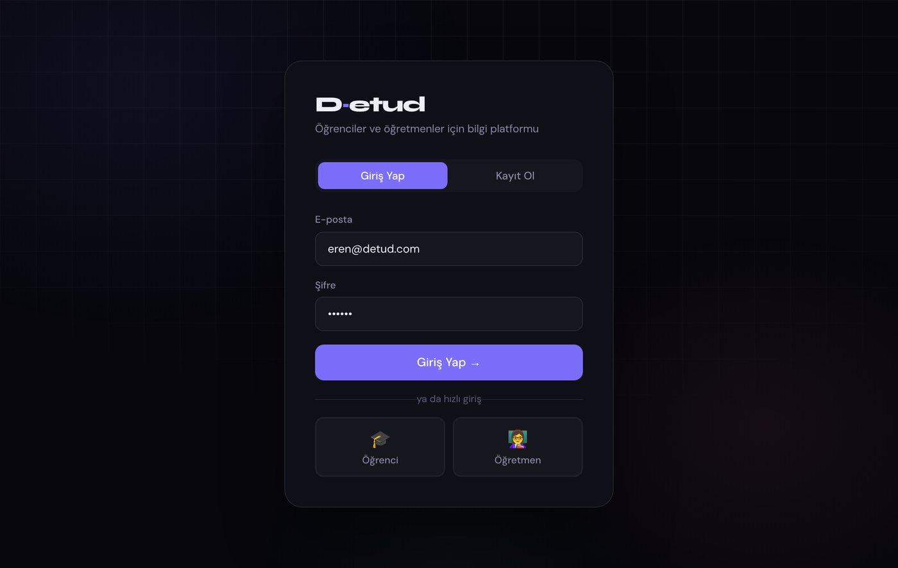
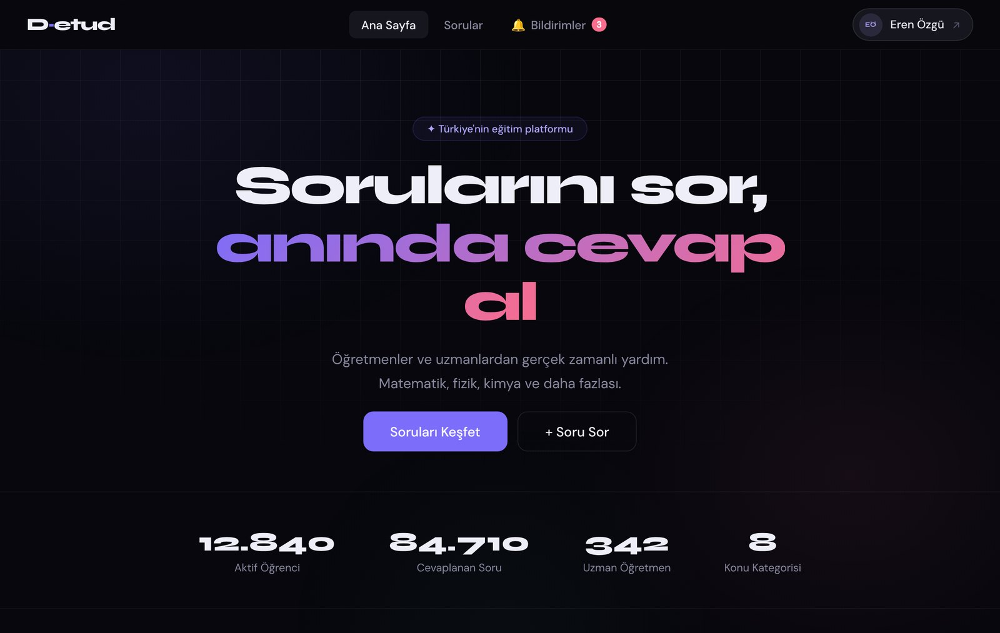
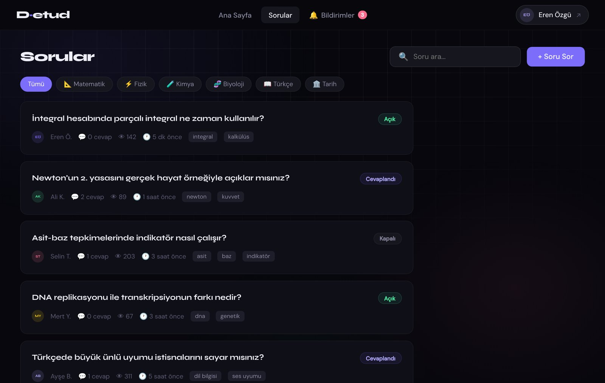
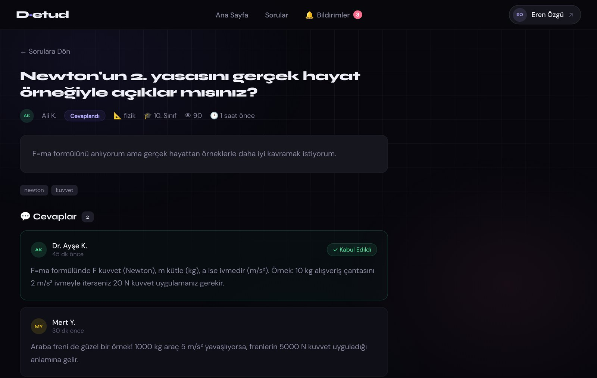
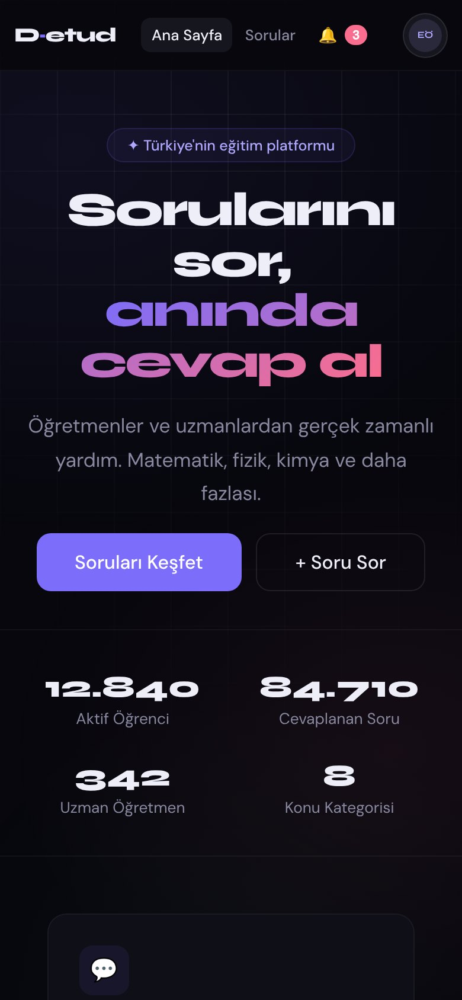
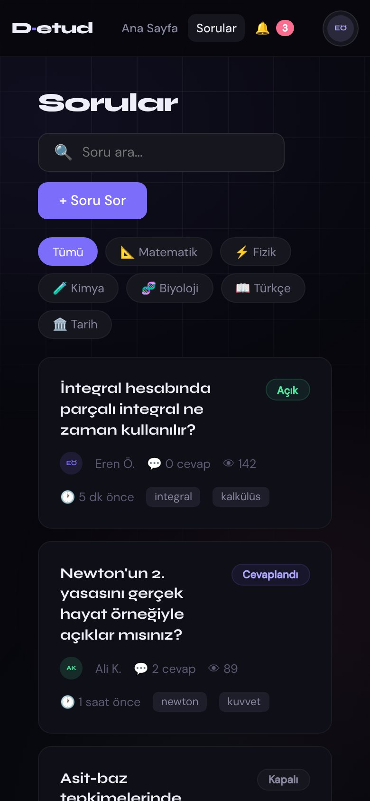

<p align="center">
  
</p>

<h1 align="center">D·etud</h1>

<p align="center">
  <b>Dijital Etüt</b>: öğrencilerin öğretmenlerinden uzaktan soru sorup cevap aldığı, mobil uyumlu eğitim platformu.<br>
  <sub>A mobile-friendly Q&amp;A platform where students ask questions and teachers answer in real time. React + Node.js + MongoDB.</sub>
</p>

<p align="center">
  <a href="https://github.com/ErenOzgu/D-etud/actions/workflows/ci.yml"></a>
  <a href="LICENSE"></a>
  
  
  
</p>

<p align="center">
  <a href="#ekran-görüntüleri">Ekran görüntüleri</a> ·
  <a href="#hızlı-başlangıç">Hızlı başlangıç</a> ·
  <a href="#api">API</a> ·
  <a href="#proje-yapısı">Proje yapısı</a> ·
  <a href="#durum-ve-yol-haritası">Durum</a>
</p>

---

> **Durum:** Bu proje bir prototiptir. React arayüzü şu an sahte (mock) verilerle çalışan, tıklanabilir bir demodur; giriş de simüle edilir. REST API (JWT, MongoDB, Socket.IO) ayrı olarak yazılmış ve birim testleri vardır, ancak arayüz henüz API'ye bağlanmamıştır. Ayrıntı: [Durum ve yol haritası](#durum-ve-yol-haritası).

## Ekran görüntüleri

<table>
  <tr>
    <td width="50%"></td>
    <td width="50%"></td>
  </tr>
  <tr>
    <td align="center"><sub>Giriş: e-posta/şifre veya rol seçerek hızlı giriş</sub></td>
    <td align="center"><sub>Ana sayfa</sub></td>
  </tr>
  <tr>
    <td width="50%"></td>
    <td width="50%"></td>
  </tr>
  <tr>
    <td align="center"><sub>Soru listesi: konu filtresi, arama, durum etiketi</sub></td>
    <td align="center"><sub>Soru detayı: cevaplar ve kabul edilen cevap</sub></td>
  </tr>
</table>

<p align="center">
  
  &nbsp;&nbsp;
  
</p>

## Özellikler

| Modül | Açıklama |
|---|---|
| **Kullanıcı girişi** | JWT tabanlı kayıt ve giriş; roller: `student`, `teacher`, `admin`; şifreler bcrypt ile saklanır. |
| **Soru-cevap** | Konu ve sınıf filtreli sorular, arama, etiketler, cevap ekleme ve soru sahibinin cevabı kabul etmesi. |
| **Bildirimler** | Kişisel Socket.IO odaları üzerinden gerçek zamanlı bildirim altyapısı; okundu işaretleme. |
| **Yönetim paneli** | İstatistikler, kullanıcıları etkinleştirme/devre dışı bırakma, soru öne çıkarma, duyuru gönderme. |

## Hızlı başlangıç

Gereksinimler: Node.js 18+ (arayüz demosu için başka bir şey gerekmez); API için ayrıca MongoDB 6+.

### Arayüz demosu (veritabanı gerekmez)

```bash
cd frontend
npm install
npm start          # http://localhost:3000
```

Giriş ekranında **Öğrenci** veya **Öğretmen** kutusuna tıklayarak hızlı giriş yapabilirsiniz. Tek dosyalık ilk prototip de [`frontend/d-etud-v2.html`](frontend/d-etud-v2.html) olarak durur; doğrudan tarayıcıda açılır.

### REST API

```bash
cd backend
cp .env.example .env     # JWT_SECRET değerini mutlaka değiştirin
npm install
npm run dev              # http://localhost:5000  (MongoDB gerekli)
npm test                 # birim testleri, veritabanı gerektirmez
```

Sağlık kontrolü: `GET http://localhost:5000/api/health`

### Ortam değişkenleri (`backend/.env`)

| Değişken | Varsayılan (örnek dosyada) | Açıklama |
|---|---|---|
| `PORT` | `5000` | API portu |
| `MONGODB_URI` | `mongodb://localhost:27017/dijital-etut` | MongoDB bağlantı adresi |
| `JWT_SECRET` | `your_super_secret_jwt_key_here` | Token imzalama anahtarı. **Üretimde uzun ve rastgele bir değerle değiştirin.** |
| `JWT_EXPIRE` | `7d` | Token geçerlilik süresi |
| `CLIENT_URL` | `http://localhost:3000` | CORS ve Socket.IO için izin verilen arayüz adresi |
| `NODE_ENV` | `development` | Çalışma ortamı |

## API

Kimlik doğrulama gerektiren uçlar `Authorization: Bearer <token>` başlığı ister.

| Yöntem | Uç nokta | Açıklama | Yetki |
|---|---|---|---|
| POST | `/api/auth/register` | Kayıt ol | herkes |
| POST | `/api/auth/login` | Giriş yap | herkes |
| GET | `/api/auth/me` | Profil bilgisi | giriş |
| PUT | `/api/auth/me` | Profili güncelle | giriş |
| GET | `/api/questions` | Soru listesi (filtre ve arama) | herkes |
| GET | `/api/questions/:id` | Soru detayı | herkes |
| POST | `/api/questions` | Soru oluştur | giriş |
| DELETE | `/api/questions/:id` | Soru sil | soru sahibi veya admin |
| POST | `/api/questions/:id/answers` | Cevap ekle | giriş |
| PUT | `/api/questions/:id/answers/:answerId/accept` | Cevabı kabul et | soru sahibi |
| GET | `/api/notifications` | Bildirimlerim | giriş |
| PUT | `/api/notifications/read-all` | Hepsini okundu işaretle | giriş |
| GET | `/api/admin/stats` | İstatistikler | admin |
| GET | `/api/admin/users` | Kullanıcı listesi | admin |
| PUT | `/api/admin/users/:id/toggle` | Kullanıcıyı etkinleştir/devre dışı bırak | admin |
| PUT | `/api/admin/questions/:id/feature` | Soruyu öne çıkar | admin |
| POST | `/api/admin/broadcast` | Tüm kullanıcılara duyuru | admin |

## Teknoloji

| Katman | Teknoloji |
|---|---|
| Arayüz | React 18, CSS Modules, Axios |
| API | Node.js, Express |
| Veritabanı | MongoDB, Mongoose |
| Kimlik doğrulama | JWT, bcryptjs |
| Gerçek zamanlı | Socket.IO |
| Test ve CI | `node:test`, GitHub Actions |

## Proje yapısı

```text
D-etud/
├── backend/                  # Node.js + Express REST API
│   ├── src/
│   │   ├── config/           # Socket.IO kimlik doğrulama ve odalar
│   │   ├── controllers/      # iş mantığı
│   │   ├── middleware/       # protect / authorize
│   │   ├── models/           # Mongoose şemaları: User, Question, Notification
│   │   ├── routes/
│   │   └── server.js
│   └── test/                 # birim testleri (veritabanı gerektirmez)
├── frontend/                 # React arayüzü
│   ├── src/
│   │   ├── components/       # ortak bileşenler, Navbar, soru sorma penceresi
│   │   ├── context/          # Auth, uygulama durumu, bildirim (toast)
│   │   ├── data/mockData.js  # demo verileri
│   │   ├── pages/
│   │   └── services/api.js   # API istemcisi (henüz arayüze bağlı değil)
│   └── d-etud-v2.html        # tek dosyalık ilk prototip
└── docs/screenshots/
```

## Durum ve yol haritası

- [x] REST API: kimlik doğrulama, sorular, cevaplar, bildirimler, yönetim uçları
- [x] Model ve yetkilendirme birim testleri, GitHub Actions ile CI
- [x] Arayüz demosu (mock veri), mobil uyumlu düzen
- [ ] Arayüzü API'ye bağlamak (`services/api.js` hazır; `AuthContext` ve `AppContext` mock'tan API'ye geçecek)
- [ ] Bildirimleri Socket.IO üzerinden arayüze taşımak
- [ ] API uçları için entegrasyon testleri (test veritabanı ile)
- [ ] Dockerfile ve `docker compose` ile tek komutla çalıştırma

## Lisans

[MIT](LICENSE) · Eren Özgü ([@ErenOzgu](https://github.com/ErenOzgu))
